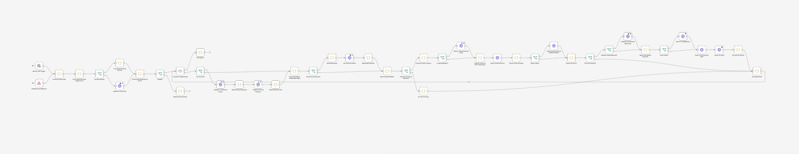

# n8n-hubspot-deal-executive-summary-slack-war-room-builder

> When a deal crosses an enterprise ARR threshold (e.g., >$50k), compiles full account firmographics, call summaries, and stakeholder maps into a dedicated #deal-&lt;company&gt; Slack channel with pinned briefs.

An n8n workflow that watches HubSpot deals. When a deal clears your ARR threshold in an eligible stage, it does the following:

1. Gathers the company's firmographics, the associated contacts and their buying roles, and the recent calls, meetings and notes.
2. Builds an **executive brief**: deal economics, a stakeholder map with coverage gaps, an activity digest with personal data removed, and risks, next steps and competitors.
3. Creates a private `#deal-<company>` Slack channel, **stamps its ID on the deal straight away**, invites the deal owner and leadership, posts the brief in Block Kit, and pins it.

It is **safe by default**. Imported as-is, it runs against a synthetic fixture (portal `99000001`): it makes zero external API calls, creates zero Slack channels and makes zero CRM updates.

---

## Contents

1. [Architecture overview](#1-architecture-overview)
2. [Prerequisites and scopes](#2-prerequisites-and-scopes)
3. [5-minute sandbox quick start](#3-5-minute-sandbox-quick-start)
4. [Step-by-step import and go-live](#4-step-by-step-import-and-go-live)
5. [Environment variables](#5-environment-variables)
6. [Threshold and idempotency rules](#6-threshold-and-idempotency-rules)
7. [Channel naming and collision handling](#7-channel-naming-and-collision-handling)
8. [Stakeholder mapping and brief synthesis](#8-stakeholder-mapping-and-brief-synthesis)
9. [Slack Block Kit brief layout](#9-slack-block-kit-brief-layout)
10. [Safety matrix](#10-safety-matrix)
11. [Compliance checklist](#11-compliance-checklist)
12. [Troubleshooting](#12-troubleshooting)
13. [Repository layout](#13-repository-layout)
14. [Disclaimer and license](#14-disclaimer--liability-limitation)

---

## 1. Architecture overview

```mermaid
flowchart LR
    subgraph T["Triggers"]
        WH["HubSpot Deal Webhook<br/>POST, secret required"]
        MT["Manual Test Trigger"]
    end
    WH --> C
    MT --> C
    C["Config & Safety Gate<br/>env only, fail-safe flags,<br/>secret check + header strip"] --> P["Parse & Authenticate<br/>Trigger Event"]
    P --> SB{"Sandbox Mode?"}
    SB -- "true (default)" --> FX["Load Synthetic Deal Context<br/>6 scenarios, offline"]
    SB -- false --> FD["HubSpot: Fetch Deal<br/>GET + associations"]
    FX --> G
    FD --> G["Threshold & Idempotency Guard<br/>ARR, currency, stage, stamp,<br/>registry, in-flight lock"]
    G --> E{"Eligible?"}
    E -- false --> SK["Skipped Deals Report"]
    E -- true --> L["Loop Over Eligible Deals<br/>one deal per iteration"]
    L -- done --> RR["Run Report"]
    L -- loop --> LC{"Live Context?"}
    LC -- true --> OW["HubSpot: Fetch Deal Owner"] --> BC["Build Context Requests"] --> CC["HubSpot Context Collector<br/>batch/read: company, contacts,<br/>calls, meetings, notes"] --> CD["Collect Deal Context"] --> SY
    LC -- "false (sandbox)" --> SY["Executive Brief &<br/>Stakeholder Map Synthesizer<br/>deterministic"]
    SY --> AI{"AI Synthesis Allowed?"}
    AI -- true --> AR["Build AI Request<br/>minimised"] --> AH["AI: Synthesize Brief"] --> AM["Merge AI Synthesis<br/>strict validation"] --> BK
    AI -- "false (default)" --> BK["Block Kit Brief Builder<br/>limits + escaping"]
    BK --> SA{"Slack Provisioning Allowed?"}
    SA -- "false (default)" --> DR["Dry-Run Preview<br/>every planned call"]
    SA -- true --> PL["Prepare Invitee Lookups"] --> LN{"Lookups Needed?"}
    LN -- true --> LU["Slack: users.lookupByEmail"] --> CI
    LN -- false --> CI["Collect Invitees &<br/>Channel Request"]
    CI --> CR["Slack: conversations.create"] --> CK["Check Channel Create"] --> NT{"Name Taken?"}
    NT -- true --> CF["Slack: create fallback<br/>&lt;name&gt;-&lt;dealId&gt;"] --> RS
    NT -- false --> RS["Resolve Channel<br/>registry / lock"]
    RS --> CO{"Channel Created?"}
    CO -- false --> PD
    CO -- true --> SG{"HubSpot Stamp Allowed?"}
    SG -- true --> ST["HubSpot: Stamp Deal War-Room<br/>PATCH channel ID + URL"] --> BI
    SG -- false --> BI["Build Invite & Brief Requests"]
    BI --> HI{"Has Invitees?"}
    HI -- true --> IN["Slack: conversations.invite"] --> PO
    HI -- false --> PO["Slack: chat.postMessage"]
    PO --> PN["Slack: pins.add"] --> PRR["Provisioning Result"] --> PD
    DR --> PD["Per-Deal Result"]
    PD --> L
```





### Key design decisions

| Decision | Why |
|---|---|
| **Stamp HubSpot immediately after the channel is created**, before invites or the post | If a later step fails, the deal is already marked, so a re-trigger can't create a second channel. |
| **Slack provisioning refuses to run while HubSpot stamping is off** | The stamp on the deal is the main idempotency key. You need an explicit `ALLOW_SLACK_WITHOUT_HUBSPOT_STAMP=true` to bypass this. |
| **No automatic retry** on `conversations.create` or `chat.postMessage` | A retry after a timeout could create a duplicate channel or a duplicate brief. Invite and pin are safe to retry, and they do. |
| **One deal per loop iteration** | A webhook batch can carry several deals. Each one gets its own isolated chain, and `$('Node').first()` resolves to the current iteration (n8n returns the latest run). |
| **Deterministic brief first, AI optional** | The brief never depends on an AI provider. AI output is validated strictly and labelled, and the deterministic brief is used whenever AI output is rejected. |
| **Everything CRM-sourced is escaped** | Note text like `<!channel>` is rendered as text and never becomes a live Slack mention. |

### Node reference

| Node | Purpose |
|---|---|
| HubSpot Deal Webhook / Manual Test Trigger | Webhook path `hubspot-deal-war-room`, responds immediately. The workflow ships **inactive**. |
| Config & Safety Gate | Reads env vars, resolves the fail-safe gates, verifies the webhook secret, and strips the secret, `Authorization` and cookie headers and the whole query string from item data. |
| Parse & Authenticate Trigger Event | Accepts HubSpot app subscription batches (`deal.propertyChange` / `deal.creation`) and the workflow *Send a webhook* action. Ignores other portals and properties, dedupes, and caps at `MAX_DEALS_PER_EXECUTION`. |
| Threshold & Idempotency Guard | Applies the eligibility rules in [§6](#6-threshold-and-idempotency-rules) and gives every skip a reason. |
| HubSpot Context Collector | Read-only `POST /crm/v3/objects/{type}/batch/read` for company, contacts, and the N newest calls, meetings and notes. Failures are recorded and noted in the brief's footer. |
| Executive Brief & Stakeholder Map Synthesizer | Formats firmographics, maps roles, finds coverage gaps, extracts risks, next steps and competitors, and generates the channel slug (see [§8](#8-stakeholder-mapping-and-brief-synthesis)). |
| AI nodes (optional) | Any OpenAI-compatible `/chat/completions` endpoint. The request is minimised and the output validated (see [§8](#8-stakeholder-mapping-and-brief-synthesis)). |
| Block Kit Brief Builder | Builds the brief within Slack's limits and escapes `&`, `<` and `>`. |
| Dry-Run Preview | Every Slack and HubSpot call that would be made, with full payloads and the list of blockers. |
| Slack provisioning chain | `users.lookupByEmail` → `conversations.create` (with name fallback) → HubSpot stamp → `conversations.invite` (`force: true`) → `chat.postMessage` → `pins.add`. |
| Per-Deal Result / Run Report / Skipped Deals Report | Status per deal: `DRY_RUN_PREVIEW`, `PROVISIONED`, `PARTIAL`, `RECONCILE_REQUIRED` or `FAILED`, plus every skip reason. |

---

## 2. Prerequisites and scopes

- **n8n** 1.x or later, with `N8N_BLOCK_ENV_ACCESS_IN_NODE=false`. If env access is blocked, the workflow falls back to sandbox defaults rather than failing open. Verified on n8n 2.47.7.
- **Node.js 18+** to run the offline simulator. It has no dependencies.
- A **HubSpot private app** in a developer test account or sandbox portal first.
- A **Slack app** with a bot user, installed to a test workspace first.
- Optional: an **AI provider** with an OpenAI-compatible API and data-processing terms that allow CRM content.

### HubSpot private app scopes

| Scope | Used for |
|---|---|
| `crm.objects.deals.read` | Fetch the deal and its associations |
| `crm.objects.deals.write` | Stamp the war-room channel ID and URL on the deal (only when `HUBSPOT_MUTATIONS_ENABLED=true`) |
| `crm.objects.companies.read` | Company firmographics (batch read) |
| `crm.objects.contacts.read` | Contacts and buying roles. HubSpot also accepts this scope for **calls, meetings and notes** batch reads; newer granular scopes such as `crm.objects.calls.read` and `crm.objects.meetings.read` are also listed for some endpoints. |
| `crm.objects.owners.read` | Deal owner name and email, so the owner can be invited |

> **About `sales-email-read`:** that scope covers *email* engagement content, which this workflow deliberately doesn't read. Emails are the activity type most likely to hold third-party personal data. Leave the scope off unless you extend the collector yourself.

### Custom deal properties (create once)

In HubSpot, go to **Settings → Properties → Deal properties → Create property**, put them in a group such as *War Room*, and match the names in your env:

| Internal name | Type | Purpose |
|---|---|---|
| `war_room_slack_channel_id` | Single-line text | **Idempotency key.** Deals with a value here are skipped. |
| `war_room_slack_channel_url` | Single-line text | Link to the channel |
| `war_room_created_at` | Date picker (datetime) | When the war room was provisioned |

To re-provision a deal on purpose, clear `war_room_slack_channel_id`.

### Slack bot token scopes

| Scope | Used for |
|---|---|
| `groups:write` | Create **private** channels and invite to them (the default, `CHANNEL_PRIVATE=true`) |
| `channels:manage` | Create **public** channels and invite to them (`CHANNEL_PRIVATE=false`) |
| `chat:write` | Post the executive brief. The bot is a member because it created the channel. |
| `pins:write` | Pin the brief |
| `users:read` + `users:read.email` | Resolve the owner and leadership emails with `users.lookupByEmail`. Slack requires `users:read.email` to be requested together with `users:read`. |

Install the app to the workspace and copy the **Bot User OAuth Token** into your secret store as `SLACK_BOT_TOKEN`.

---

## 3. 5-minute sandbox quick start

**Step 1. Run the offline simulator (no n8n, no network, about 1 second).**

```bash
git clone <your-private-copy-of-this-repo>
cd n8n-hubspot-deal-executive-summary-slack-war-room-builder
node scripts/simulate-sandbox-run.js
```

The simulator only loads `fs`, `path` and `vm`. It contains a small n8n-style engine that follows `workflow.json`'s connections, runs every Code node verbatim, evaluates the IF and HTTP expressions, emulates the loop node, and routes HTTP nodes to in-memory HubSpot, Slack and AI mocks. Its 128 checks cover structure and static safety, safe defaults, webhook authentication, gating, slugs and collisions, stakeholder mapping, redaction, Block Kit limits and escaping, AI minimisation and validation, call ordering, idempotency, and partial failures. It ends with:

```
✅ 128 passed, 0 failed
Output written to: sim-output/ (git-ignored)
```

Paste `sim-output/block-kit-deal-acme-enterprise.json` into Slack's **Block Kit Builder** to see the brief rendered. Other output files: `dry-run-preview.json`, `sandbox-run-report.json`, and `armed-run-call-log.json` (the mocked fully armed run).

**Step 2. Import into n8n.** Go to **Workflows → Import from File** and select `workflow.json`. No credentials are needed.

**Step 3. Execute.** Click **Test workflow**. The six fixture deals go through the guard:

| Deal | Result |
|---|---|
| Acme Enterprise Corp, $185,000 | `DRY_RUN_PREVIEW`, brief for `#deal-acme-enterprise` |
| Northstar Logistics, Inc., $96,500 | `DRY_RUN_PREVIEW`, brief for `#deal-northstar-logistics` with 3 coverage gaps |
| Bluebird Bakery Co, $12,000 | `SKIP_BELOW_THRESHOLD` |
| Pinecrest Analytics, $240,000 | `SKIP_ALREADY_PROVISIONED` (channel `C99000077` already stamped) |
| Harborview Media, $75,000 | `SKIP_STAGE_EXCLUDED` (closedlost) |
| Zürich Café Systems AG, €80,000 | `SKIP_CURRENCY_MISMATCH` |

Open **Dry-Run Preview** to see every Slack and HubSpot call that would be made, with full payloads.

---

## 4. Step-by-step import and go-live

Each stage changes one thing. Do all of them in a test portal and test workspace first.

### Stage A: live reads, dry run (validates HubSpot scopes)

```bash
SANDBOX_MODE=false
HUBSPOT_ACCESS_TOKEN=<from secret store>
HUBSPOT_PORTAL_ID=<numeric test-portal ID>
TEST_DEAL_ID=<a test deal above the threshold>
# DRY_RUN stays true; Slack/HubSpot mutations stay false
```

Restart n8n and run the Manual Test Trigger. Check the brief in **Block Kit Brief Builder** and the footer for `context source(s) unavailable`. If any source is listed, add the missing scope.

### Stage B: connect the webhook (still dry run)

1. Generate a secret of 16+ random characters and store it as `WEBHOOK_SHARED_SECRET`.
2. Activate the workflow and copy the production URL of **HubSpot Deal Webhook** (`…/webhook/hubspot-deal-war-room`).
3. Pick one trigger source:
   - **HubSpot workflow "Send a webhook" action** (simplest, and available only on some HubSpot subscription tiers). Enrol deals where *Amount ≥ 50,000* and the stage is not closed, and send a `POST` to the URL with the header `x-war-room-secret: <secret>`.
   - **HubSpot developer-app webhook subscription** to `deal.propertyChange` on `amount` and `dealstage`. Subscriptions can't add custom headers, so append `?war_room_secret=<secret>` to the target URL. HubSpot's own `X-HubSpot-Signature-v3` is not verified by this workflow; verify it at your reverse proxy if you need it.
4. Change a test deal's amount. The execution should end at **Dry-Run Preview**.

> n8n saves the webhook trigger's raw input, headers and query included, in execution history. Restrict who can view executions, and set `EXECUTIONS_DATA_PRUNE` and `EXECUTIONS_DATA_MAX_AGE` to suit your retention policy.

### Stage C: arm the stamp and Slack

1. Create the three custom deal properties ([§2](#2-prerequisites-and-scopes)).
2. Set:
   ```bash
   DRY_RUN=false
   HUBSPOT_MUTATIONS_ENABLED=true
   SLACK_MUTATIONS_ENABLED=true
   SLACK_BOT_TOKEN=<from secret store>
   SLACK_WORKSPACE_URL=https://<your-workspace>.slack.com
   LEADERSHIP_SLACK_USER_IDS=<IDs>    # and/or LEADERSHIP_EMAILS
   ```
3. Run the Manual Test Trigger once. Confirm the private channel, the invites, the pinned brief and the stamped deal.
4. Run it again. It should report `SKIP_ALREADY_PROVISIONED` and make no Slack calls.
5. Configure an n8n **Error Workflow** so failures alert an owner.

### Stage D (optional): AI-assisted summaries

Confirm that your provider's data-processing terms allow CRM content, then set `AI_ENABLED=true`, `AI_API_KEY`, `AI_MODEL` and, if needed, `AI_API_BASE_URL`. Review several briefs before you rely on them.

---

## 5. Environment variables

| Variable | Default | Description |
|---|---|---|
| `SANDBOX_MODE` | `true` | **Safe-ON.** Synthetic fixture, synthetic portal, zero network calls. Turns off only with an explicit `false`/`0`/`no`/`off`. |
| `DRY_RUN` | `true` | **Safe-ON.** The brief is built and previewed; nothing is written. |
| `SLACK_MUTATIONS_ENABLED` | `false` | **Safe-OFF.** Allows channel create, invite, post and pin. Turns on only with `true`/`1`/`yes`/`on`. |
| `HUBSPOT_MUTATIONS_ENABLED` | `false` | **Safe-OFF.** Allows the war-room stamp `PATCH`. |
| `AI_ENABLED` | `false` | **Safe-OFF.** Optional AI synthesis. Never used in sandbox mode. |
| `ALLOW_SLACK_WITHOUT_HUBSPOT_STAMP` | `false` | Lets Slack run without the stamp. This risks duplicate channels. |
| `ARR_THRESHOLD` | `50000` | Minimum deal value. |
| `ARR_PROPERTY` | `amount` | Deal property to compare (`amount`, `hs_arr`, `hs_acv` or a custom property). |
| `THRESHOLD_CURRENCY` | `USD` | Deals in another currency are skipped unless `ALLOW_CURRENCY_MISMATCH=true`. |
| `ELIGIBLE_PIPELINES` / `ELIGIBLE_DEAL_STAGES` | empty | Optional allowlists. Empty means any. |
| `EXCLUDED_DEAL_STAGES` | `closedwon,closedlost` | Denylist. |
| `TRIGGER_PROPERTIES` | `amount,dealstage,hs_arr,hs_acv,pipeline` | `propertyChange` events for other properties are ignored. |
| `DEAL_STAGE_LABELS` | empty | `stageId:Label,…` for custom stage IDs. HubSpot's default stages already have readable labels. |
| `HUBSPOT_ACCESS_TOKEN` | — | Private app token. Required in live mode. |
| `HUBSPOT_PORTAL_ID` | — | Numeric portal ID. Required in live mode; forced to `99000001` in sandbox. |
| `HUBSPOT_API_BASE_URL` / `HUBSPOT_APP_BASE_URL` | `https://api.hubapi.com` / `https://app.hubspot.com` | Use `https://app-eu1.hubspot.com` for EU portals' record links. |
| `HUBSPOT_STAMP_*_PROPERTY` | `war_room_slack_channel_id`, `war_room_slack_channel_url`, `war_room_created_at` | Stamp targets. Set URL or created-at to empty to skip them. |
| `TEST_DEAL_ID` | — | Deal used by the Manual Test Trigger in live mode. |
| `MAX_CONTACTS` / `MAX_ENGAGEMENTS_PER_TYPE` | `50` / `10` | Context collection caps. |
| `BRIEF_INCLUDE_CONTACT_NAMES` | `true` | `false` shows "Contact 1, 2…" in the brief. |
| `WEBHOOK_SHARED_SECRET` | — | 16+ characters. Required for live webhooks, which fail closed without it. |
| `MAX_DEALS_PER_EXECUTION` | `10` | Cap per webhook batch. |
| `SLACK_BOT_TOKEN` | — | Bot User OAuth token. |
| `SLACK_API_BASE_URL` | `https://slack.com/api` | Override for GovSlack or a test double. |
| `SLACK_WORKSPACE_URL` | — | Used for stamped channel links (`…/archives/<id>`). |
| `CHANNEL_PREFIX` | `deal-` | Sanitised to `[a-z0-9_-]`, maximum 20 characters, hyphen appended. |
| `CHANNEL_PRIVATE` | `true` | Private channels by default. |
| `SLUG_STRIP_LEGAL_SUFFIXES` | `true` | Drops trailing Inc, LLC, Ltd, Corp, GmbH, AG and similar. |
| `INVITE_DEAL_OWNER` | `true` | Invites the HubSpot deal owner, resolved by email. |
| `LEADERSHIP_SLACK_USER_IDS` / `LEADERSHIP_EMAILS` | — | Always-invited leadership. Invalid entries are dropped with a warning. |
| `MAX_INVITEES` | `25` | Hard cap of 100 (Slack's per-call limit). |
| `IDEMPOTENCY_LOCK_TTL_MINUTES` | `30` | In-flight lock lifetime. |
| `AI_API_KEY` / `AI_API_BASE_URL` / `AI_MODEL` | — / `https://api.openai.com/v1` / — | AI provider. `AI_MODEL` is required, and `https` is enforced. |
| `AI_JSON_MODE` | `true` | Sends `response_format: json_object`. Set `false` for providers that reject it. |
| `AI_INCLUDE_CONTACT_NAMES` | `false` | By default the AI sees "Stakeholder 1…" and titles only. |
| `AI_MAX_INPUT_CHARS` | `6000` | Input cap. |
| `NOW_OVERRIDE` | — | Pins "now" for reproducible tests. |
| `N8N_BLOCK_ENV_ACCESS_IN_NODE` | n8n default | Must be `false`. |

### Sample `.env`

```bash
# Stage A: live HubSpot reads against a TEST portal, nothing written anywhere
N8N_BLOCK_ENV_ACCESS_IN_NODE=false
SANDBOX_MODE=false
DRY_RUN=true
SLACK_MUTATIONS_ENABLED=false
HUBSPOT_MUTATIONS_ENABLED=false
AI_ENABLED=false

HUBSPOT_ACCESS_TOKEN=<injected-from-secret-manager>
HUBSPOT_PORTAL_ID=99000001
TEST_DEAL_ID=990001001
ARR_THRESHOLD=50000
ARR_PROPERTY=amount

WEBHOOK_SHARED_SECRET=<injected-from-secret-manager>
SLACK_WORKSPACE_URL=https://example-workspace.slack.com
LEADERSHIP_SLACK_USER_IDS=U99000001
LEADERSHIP_EMAILS=cro@example.com
```

The complete template is in [`.env.example`](.env.example).

---

## 6. Threshold and idempotency rules

The guard checks every candidate deal in this order. The first rule that fails is reported as the decision.

| # | Rule | Decision on failure |
|---|---|---|
| 1 | The deal can be read (live fetch succeeded) | `SKIP_FETCH_FAILED` |
| 2 | `ARR_PROPERTY` holds a number | `SKIP_NO_VALUE` |
| 3 | Value ≥ `ARR_THRESHOLD` | `SKIP_BELOW_THRESHOLD` |
| 4 | `deal_currency_code` = `THRESHOLD_CURRENCY` (or the mismatch is allowed) | `SKIP_CURRENCY_MISMATCH` |
| 5 | Pipeline is in `ELIGIBLE_PIPELINES` (if set) | `SKIP_PIPELINE` |
| 6 | Stage is not in `EXCLUDED_DEAL_STAGES` | `SKIP_STAGE_EXCLUDED` |
| 7 | Stage is in `ELIGIBLE_DEAL_STAGES` (if set) | `SKIP_STAGE_NOT_ELIGIBLE` |
| 8 | **No channel ID stamped on the deal** (the source of truth) | `SKIP_ALREADY_PROVISIONED` |
| 9 | No channel in the workflow registry (secondary guard) | `SKIP_ALREADY_PROVISIONED` |
| 10 | No unexpired in-flight lock for the deal | `SKIP_LOCKED` |

**Layers of duplicate protection:**

1. **The HubSpot stamp** is written immediately after `conversations.create` succeeds, before invites, the post or the pin. That's why Slack provisioning requires stamping by default.
2. **The workflow registry** (n8n workflow static data) records `dealId → channelId`. It covers the window where a stamp `PATCH` failed.
3. **In-flight locks.** When Slack is armed, an eligible deal is locked for `IDEMPOTENCY_LOCK_TTL_MINUTES`, so two near-simultaneous webhooks (amount and stage changed together) can't both provision. A failed provisioning releases the lock.
4. **No auto-retry** on channel create or brief post.
5. **Webhook dedupe** within one batch.

> n8n persists workflow static data **only for production (trigger-activated) executions**, not manual test runs. The HubSpot stamp is the guarantee that always applies.

---

## 7. Channel naming and collision handling

**Slug algorithm** (company name, or the deal-name prefix if no company is associated):

1. Transliterate (`ß→ss`, `æ→ae`, `ø→o`, and so on), apply Unicode NFKD, and strip diacritics.
2. Lowercase, turn `&` into `and`, and drop apostrophes.
3. Split on anything outside `[a-z0-9]` and join with `-`.
4. Strip trailing legal suffixes (`inc`, `llc`, `ltd`, `corp`, `gmbh`, `ag`, `sa`, `plc` and others) while more than one word remains.
5. Prefix with `CHANNEL_PREFIX`, cut on a word boundary to Slack's **80-character** limit, and validate against `^[a-z0-9][a-z0-9_-]{0,79}$`.
6. If the result is empty (for example a name in a non-Latin script), use the deal ID.

| Company | Channel |
|---|---|
| Acme Enterprise Corp | `#deal-acme-enterprise` |
| Northstar Logistics, Inc. | `#deal-northstar-logistics` |
| Zürich Café Systems AG | `#deal-zurich-cafe-systems` |
| AT&T Field Services | `#deal-at-and-t-field-services` |
| O'Neil & Sons Ltd. | `#deal-oneil-and-sons` |
| 株式会社サンプル | `#deal-<dealId>` |

**Collisions:**

| Situation | Behaviour |
|---|---|
| `#deal-acme-enterprise` is free | Created |
| Slack returns `name_taken` | One retry with the deterministic fallback `#deal-acme-enterprise-<dealId>` |
| Both names are taken | `RECONCILE_REQUIRED`. Nothing is posted, the deal is not stamped, and the lock is released. An earlier run probably created the channel without stamping it: find the channel, put its ID in `war_room_slack_channel_id`, and the deal is protected from then on. |
| Archived channel with the same name | Slack still reports `name_taken`. The fallback name is used. |

---

## 8. Stakeholder mapping and brief synthesis

### Buying committee

1. **HubSpot buying role first.** The contact property `hs_buying_role` is multi-select; internal values and labels are both accepted. It maps to Executive Sponsor, Budget Holder, Decision Maker, Champion, Influencer, End User, Blocker, Legal & Compliance, or Other.
2. **Job-title inference second**, flagged *(inferred from title)* in the brief:

| Title pattern | Inferred role |
|---|---|
| CFO, VP Finance, Controller, Treasurer | Budget Holder |
| CEO, COO, President, Founder, MD, GM | Executive Sponsor |
| Counsel, Legal, Compliance, Privacy | Legal & Compliance |
| Procurement, Purchasing, Sourcing | Procurement |
| CxO, SVP, VP, Head of, Director | Decision Maker |
| Architect, Engineer, Security, IT, Admin | Technical Evaluator |
| Manager, Lead, Supervisor | Influencer |
| Analyst, Specialist, Coordinator | End User |

3. **Coverage.** Executive Sponsor, Budget Holder and Champion are *core roles*; each missing one becomes a risk and a ⚠️ badge. Decision Maker, Legal & Compliance and Technical Evaluator are *recommended*. Champion is never inferred from a title.

### Activity digest, risks and next steps

- The newest `MAX_ENGAGEMENTS_PER_TYPE` calls, meetings and notes are collected, HTML is stripped, and **emails, phone numbers and links are redacted** before any text reaches Slack or an AI provider.
- Sentences that match next-step language ("next step", "action item", "follow up", "send", "schedule", "deliver"…) become **next steps**. Risk language ("concern", "blocker", "delay", "security review", "liability", "competitive bids", "renews"…) becomes **risks**. "Competitor X" mentions are collected separately.
- **Derived risks:** missing core roles; close date ≤ 30 days while still at an early stage; close date passed; no activity for more than 21 days; no contacts.

### Optional AI synthesis

| Control | Detail |
|---|---|
| Off by default | It needs `AI_ENABLED=true`, live mode, `AI_API_KEY`, an explicit `AI_MODEL` and an `https` endpoint. |
| Data minimisation | Sends firmographics, deal economics, roles and titles ("Stakeholder 1…" unless `AI_INCLUDE_CONTACT_NAMES=true`) and redacted excerpts. Never emails, phone numbers, links or record IDs. |
| Prompt-injection posture | CRM text is wrapped and declared untrusted. The model returns JSON only, and its output is display text that can never trigger an action. |
| Output validation | Strict JSON schema with length caps. Any email, phone number, URL or Slack mention (`<!channel>`, `@here`) rejects the whole response. |
| Fallback | On rejection, timeout or error, the deterministic brief is used and the reason is noted in the brief's footer. |
| Labelling | AI-generated sections are marked *AI-assisted, verify before acting*. |

---

## 9. Slack Block Kit brief layout

The brief generated by the simulator for the Acme fixture has 17 blocks (Slack's limit is 50):

```
┌───────────────────────────────────────────────────────────────────────┐
│ HEADER   Executive Brief: Acme Enterprise Corp [SANDBOX]              │
│ CONTEXT  deal name · Synthetic test data · Generated … · Deterministic│
│ FIELDS   Deal value $185,000 (3.7x the $50,000 threshold) │ Stage     │
│          Close date 2027-01-29 (in 73 days) │ Owner │ Priority        │
│          Buying-committee coverage 100% of core roles                 │
├───────────────────────────────────────────────────────────────────────┤
│ (AI)     🤖 Executive summary (AI-assisted), only when enabled        │
├───────────────────────────────────────────────────────────────────────┤
│ SECTION  🏢 Account firmographics                                     │
│ FIELDS   Industry │ Employees │ Annual revenue │ HQ │ Domain │ Lifecycle│
│ CONTEXT  company description (≤ 400 chars)                            │
├───────────────────────────────────────────────────────────────────────┤
│ SECTION  👥 Buying committee & stakeholder map (6 contacts)           │
│          👑 Executive Sponsor: Dana Whitfield, Chief Operating Officer│
│          💰 Budget Holder: Priya Raman, VP, Finance & FP&A            │
│          ⭐ Champion: Marcus Lee, Director of Logistics Systems        │
│          ⚖️ Legal & Compliance: Elena Sorensen _(inferred from title)_ │
│ CONTEXT  ✅ Executive Sponsor  ✅ Budget Holder  ✅ Champion           │
├───────────────────────────────────────────────────────────────────────┤
│ SECTION  🔍 Recent engagement (4 logged, last 2 days ago)              │
│          📝 2026-11-15 · Note  > …See [link removed] for draft.       │
│ SECTION  🚨 Risks          • Security review will take 3-4 weeks …     │
│ SECTION  🎯 Next steps     • Deliver TCO model … by 2026-11-24 …       │
│ CONTEXT  ⚔️ Competitors mentioned: RouteGrid                           │
├───────────────────────────────────────────────────────────────────────┤
│ ACTIONS  [Open deal in HubSpot]  [Open company]                       │
│ CONTEXT  War-room brief · deal 990001001 · run wr-…                   │
└───────────────────────────────────────────────────────────────────────┘
```

**Limits enforced:** at most 50 blocks, header ≤ 150 characters, section text ≤ 3,000, at most 10 fields of ≤ 2,000 each, button text ≤ 75, `https` button URLs only, and fallback `text` ≤ 300. `unfurl_links` and `unfurl_media` are off. Every CRM-sourced string has `&`, `<` and `>` escaped.

---

## 10. Safety matrix

| Control | Default | Effect when default | To change |
|---|---|---|---|
| `SANDBOX_MODE` | `true` | Synthetic fixture, synthetic portal, **zero network calls** | Explicit `false` |
| `DRY_RUN` | `true` | Brief built and previewed, nothing written | Explicit `false` |
| `SLACK_MUTATIONS_ENABLED` | `false` | No channel, invite, post or pin | Explicit `true` |
| `HUBSPOT_MUTATIONS_ENABLED` | `false` | No deal `PATCH` | Explicit `true` |
| Slack without stamp | refused | No provisioning without the idempotency key | `ALLOW_SLACK_WITHOUT_HUBSPOT_STAMP=true` |
| `AI_ENABLED` | `false` | Deterministic brief, no data sent to AI | `true` + key + model (live only) |
| Workflow `active` | `false` | Webhook not registered after import | Activate in n8n |
| Blocked `$env` | — | All safe defaults | `N8N_BLOCK_ENV_ACCESS_IN_NODE=false` |
| Typo in a flag | — | Treated as the safe value | Use `true` / `false` |
| Live webhook auth | required | No secret, or a wrong one, rejects the event before any API call | Set `WEBHOOK_SHARED_SECRET` |
| Secret in item data | stripped | The header and query string are removed in the first Code node | — |
| Foreign portal events | ignored | Events for other portal IDs are dropped | — |
| HubSpot writes | 1 node | Only *Stamp Deal War-Room* can `PATCH`; other non-GET requests are batch reads | — |
| Private channels | `true` | Deal data is visible only to invitees | `CHANNEL_PRIVATE=false` |
| Invite cap | 25 | Never more than `MAX_INVITEES` (max 100) | `MAX_INVITEES` |
| Mentions from CRM text | escaped | `<!channel>` in notes is rendered as text | — |
| PII in notes | redacted | Emails, phone numbers and links are removed from excerpts | — |
| Email engagements | not read | No `sales-email-read` needed | — |
| Create / post retries | off | No duplicate channels or briefs | — |
| Double name collision | `RECONCILE_REQUIRED` | Both names taken: nothing posted, lock released | Manual stamp |

---

## 11. Compliance checklist

- [ ] Internal approval exists for copying CRM account, contact and engagement data into Slack, and the purpose is documented.
- [ ] War rooms are **private** (`CHANNEL_PRIVATE=true`), and leadership invite lists hold only people with a business need.
- [ ] Slack retention, export and legal-hold policies cover `#deal-*` channels. There is an owner for archiving closed deals' channels.
- [ ] The HubSpot private app has only the scopes in [§2](#2-prerequisites-and-scopes). Its token and the Slack bot token live only in the secret store and n8n env, and both have a rotation schedule.
- [ ] `WEBHOOK_SHARED_SECRET` is 16+ random characters, rotated, and not reused elsewhere.
- [ ] n8n execution history (which includes webhook input) has restricted access and a pruning policy.
- [ ] The team understands that contact **names and titles** appear in the brief (`BRIEF_INCLUDE_CONTACT_NAMES`), while emails and phone numbers never do.
- [ ] Before `AI_ENABLED=true`: the AI provider's data-processing agreement covers CRM content, data residency is acceptable, and `AI_INCLUDE_CONTACT_NAMES` stays `false` unless justified.
- [ ] Stages A to C were completed in a **test portal and test workspace** before production.
- [ ] The three custom deal properties exist, and `war_room_slack_channel_id` is read-only for most users.
- [ ] An n8n Error Workflow alerts an owner, and `PARTIAL` and `RECONCILE_REQUIRED` results are reviewed.
- [ ] `node scripts/simulate-sandbox-run.js` passes after every change to `workflow.json`.
- [ ] The first briefs were reviewed by a person before the team relies on them.

---

## 12. Troubleshooting

| Symptom | Cause and fix |
|---|---|
| Always runs in sandbox despite `SANDBOX_MODE=false` | `$env` is blocked. Set `N8N_BLOCK_ENV_ACCESS_IN_NODE=false` and restart. The Config output shows `envBlocked: true`. |
| `Live mode … refused` | `HUBSPOT_ACCESS_TOKEN` is missing or `HUBSPOT_PORTAL_ID` is not numeric. |
| `Webhook rejected …` | The secret is missing or wrong, or `WEBHOOK_SHARED_SECRET` is shorter than 16 characters. Check the header name `x-war-room-secret` or the query parameter `war_room_secret`. |
| Webhook fires but nothing happens | The event was for another property (`TRIGGER_PROPERTIES`), another portal, or the deal was skipped. See **Skipped Deals Report**. |
| Dry-Run Preview despite flags set | Read `blockedBy`. A common cause is Slack waiting for `HUBSPOT_MUTATIONS_ENABLED=true`. |
| Brief footer: `context source(s) unavailable: calls` | A missing scope. See [§2](#2-prerequisites-and-scopes). |
| Deal owner not invited | Missing `crm.objects.owners.read`, or the owner's HubSpot email differs from their Slack email (see `unresolvedInvitees`). |
| `missing_scope` from Slack | Add the scope from [§2](#2-prerequisites-and-scopes) and **reinstall** the Slack app. |
| `RECONCILE_REQUIRED` | Both channel names exist. See [§7](#7-channel-naming-and-collision-handling). |
| `PARTIAL` | The channel and stamp exist, but a later step (invite, post or pin) failed. The error is in `steps`. Repost manually, or clear the stamp, archive the channel and re-run. |
| AI section missing | Read the footer note `AI synthesis skipped: …`: validation rejected the output or the provider returned an error. |

---

## 13. Repository layout

```
.
├── workflow.json                                 # n8n workflow (45 nodes, inactive on import)
├── README.md
├── DISCLAIMER.md
├── LICENSE
├── .env.example
├── .gitignore
├── sample-payloads/
│   └── enterprise-deal-context-fixture.json      # synthetic deals, companies, contacts, notes
└── scripts/
    └── simulate-sandbox-run.js                   # offline engine + mocks, zero network modules
```

---

## 14. ⚠️ Disclaimer & Liability Limitation

**Use at your own risk.** The code, workflows, and scripts in this repository (**n8n-hubspot-deal-executive-summary-slack-war-room-builder**) are provided for educational and architectural demonstration purposes.

**No Liability:** The author and dhRobin Systems accept no responsibility or liability for any direct, indirect, incidental, or consequential damages that result from using, misusing, or deploying these scripts, including channels created in error or shared with the wrong people, exposed deal or contact information, inaccurate briefs, or incorrect deal properties.

**No Warranty:** All software, n8n JSON blueprints, JavaScript modules, and prompts are provided "AS IS", without warranty of any kind, express or implied. This includes, but is not limited to, warranties of merchantability, fitness for a particular purpose, and non-infringement.

**Production Testing Required:** Always test thoroughly in an isolated staging environment, such as a HubSpot developer test account or sandbox and a test Slack workspace, with `SANDBOX_MODE=true` and `DRY_RUN=true` enabled, before you connect live HubSpot, Slack or AI credentials. Treat every executive brief, stakeholder map and AI-assisted summary as a draft that a person must review before it's relied on.

**Third-Party APIs & Compliance:** You alone are responsible for complying with the terms of service, rate limits, data privacy regulations (GDPR/CCPA), and security policies of HubSpot, Slack, your AI provider and any connected services. That includes confirming a lawful basis for copying CRM data into Slack and for sending it to an AI provider, keeping war rooms private and limited to people with a business need, applying retention policies to the channels created, and reviewing every automatically created channel and updated record.

The full disclaimer is also available in [DISCLAIMER.md](DISCLAIMER.md).

## License

Released under the MIT License. Copyright (c) 2026 DH Robin (dhRobin Systems). See [LICENSE](LICENSE).

---

Full text: DISCLAIMER.md · Licensed under the MIT License. License: MIT © 2026 DH Robin (dhRobin Systems) · Provided as-is, see the disclaimer.
